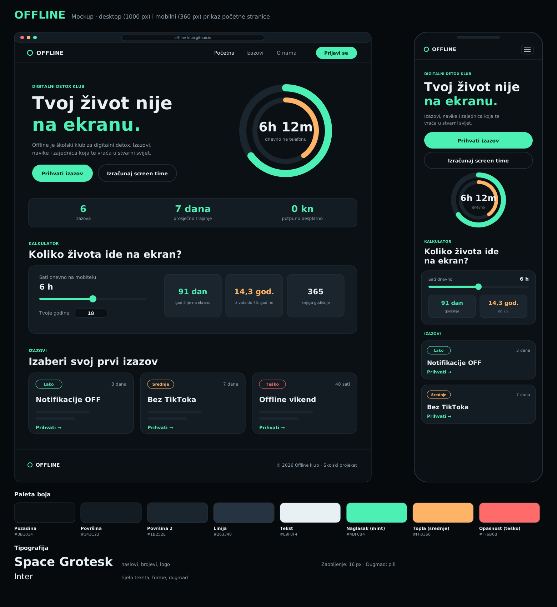

# OFFLINE — digitalni detox klub

> **Tvoj život nije na ekranu.**
> Web stranica školskog kluba koji pomaže učenicima da smanje vrijeme na mobitelu kroz izazove, svijest o navikama i zajednicu.

Školski projekat iz predmeta **Softversko inženjerstvo** (4. razred gimnazije, IT smjer, školska 2026/2027, prof. Admir Demir). Rad u paru, tema: *Git alati i tehnologije + izrada web stranice*.



## Šta stranica nudi

| Stranica | Sadržaj | Posebnosti |
|---|---|---|
| `index.html` | Hero s CTA dugmadima, statistike, **kalkulator screen timea**, teaser izazova | JS kalkulator: koliko dana godišnje i godina života odlazi na telefon |
| `izazovi.html` | Šest izazova u karticama | JS filtriranje po težini (Lako / Srednje / Teško) |
| `o-nama.html` | Misija, vrijednosti, članovi tima, česta pitanja | JS harmonika (FAQ) |
| `kontakt.html` | Forma za prijavu na izazov | JS validacija, poruka o uspjehu, predodabir izazova iz linka |

Stranica je **responzivna** (mobitel i računar), bez frameworka: čisti HTML5, CSS3 i JavaScript.

## Pokretanje

Nije potrebna instalacija.

```bash
git clone https://github.com/consoleSudo/1.-Digital-detox-klub
cd 1.-Digital-detox-klub
```

Otvori `index.html` dvoklikom u pregledniku, ili (preporučeno) iz VS Codea s ekstenzijom **Live Server**.

## Struktura projekta

```
.
├── index.html
├── izazovi.html
├── o-nama.html
├── kontakt.html
├── css/
│   ├── base.css        # boje, reset, navigacija, footer, dugmad
│   ├── home.css        # početna stranica
│   ├── izazovi.css     # kartice izazova
│   ├── about.css       # o nama
│   └── contact.css     # forma
├── js/
│   ├── nav.js          # mobilni meni
│   ├── kalkulator.js   # kalkulator screen timea
│   ├── izazovi.js      # filtriranje izazova
│   ├── faq.js          # harmonika
│   └── forma.js        # validacija i predodabir izazova
├── images/
├── docs/
│   ├── DIZAJN.md
│   ├── wireframe.png / .svg
│   └── mockup.png / .svg
└── README.md
```

## Tim i rad s Gitom

| Učenik | Branch | Dio projekta |
|---|---|---|
| Muhamed Karčić | `feature/muhamed-karcic` | wireframe, mockup, početna, kalkulator, izazovi |
| Arijan Tiro | `feature/arijan-tiro` | README, dokumentacija, o nama, kontakt forma |

- Svaki učenik radi na vlastitom branchu, bez direktnih commitova na `main`.
- Spajanje u `main` radi se tek nakon pregleda i odobrenja profesora.
- Opis dizajna i strukture stranica: [`docs/DIZAJN.md`](docs/DIZAJN.md).

## Dizajn

- **Boje:** tamna podloga `#0B1014`, naglasak mint `#4DF0B4`, topla `#FFB366`
- **Fontovi:** Space Grotesk (naslovi), Inter (tekst)
- Wireframe: [`docs/wireframe.png`](docs/wireframe.png) · Mockup: [`docs/mockup.png`](docs/mockup.png)

## Autori

- Muhamed Karčić — `@consoleSudo`
- Arijan Tiro — `@abusin3ss-cmyk`

*Školski projekat, 2026.*
