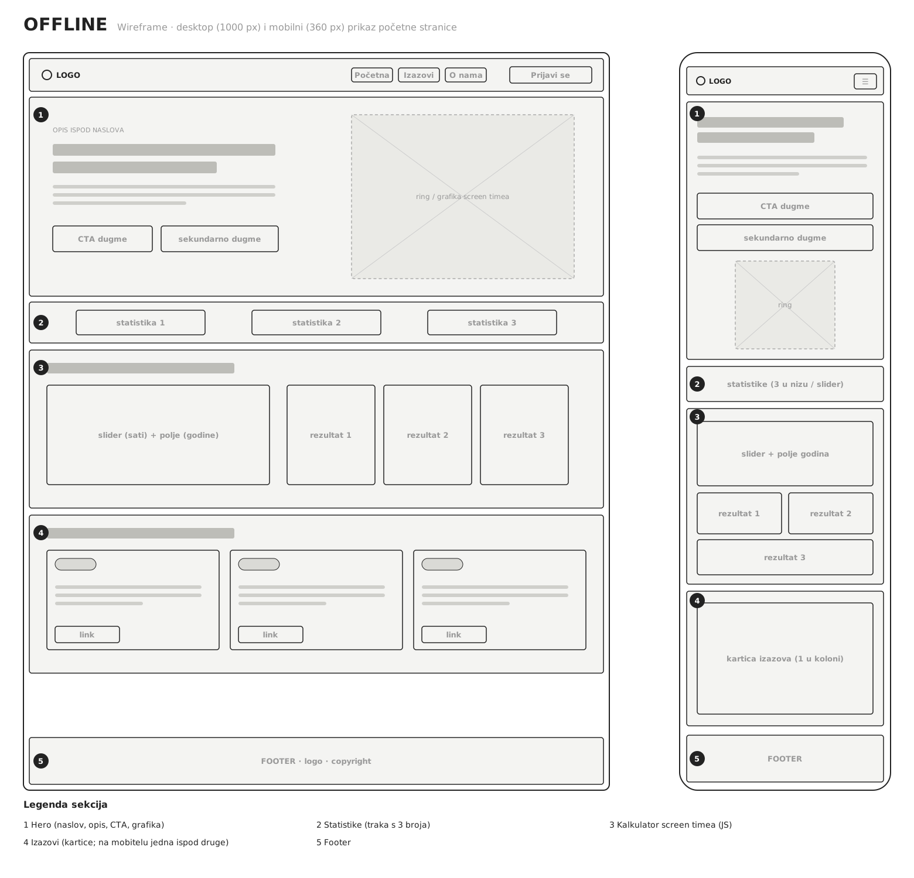
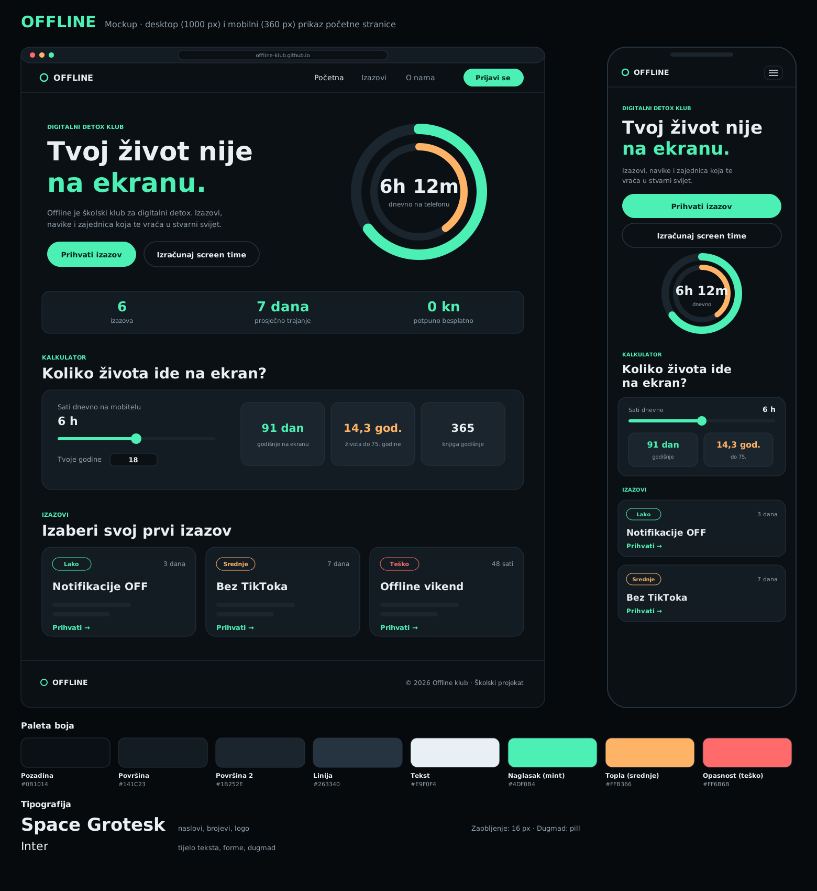

# OFFLINE — opis dizajna i strukture stranice

**Predmet:** Softversko inženjerstvo · 4. razred gimnazije (IT smjer) · prof. Admir Demir
**Rad u paru:** Muhamed Karčić i Arijan Tiro · **Rok:** 15. 11. 2026. do 22:00

Ovaj dokument opisuje koncept, dizajn (wireframe, mockup, boje, fontove), strukturu fajlova i sadržaj stranica. Podjela posla i link na repozitorij nalaze se u izvještaju.

---

## 1. Koncept

**Offline** je školski klub za digitalni detox. Misija: pomoći učenicima da smanje vrijeme na mobitelu kroz kratke izazove i svijest o tome koliko vremena zaista odlazi na ekran.

- **Slogan:** *Tvoj život nije na ekranu.*
- **Ton:** direktan, malo drzak, bez moraliziranja. Obraćanje s "ti".
- **Ciljna grupa:** učenici srednjih škola.
- **Jedna jaka JS funkcionalnost:** kalkulator screen timea (sekcija 4.2), uz filter izazova i validaciju forme.

Zahtjevi iz zadatka i gdje su ispunjeni:

| Zahtjev | Gdje |
|---|---|
| Početna (hero, opis, CTA) | `index.html` |
| O nama / Članovi | `o-nama.html` |
| Projekti / Galerija (kartice) | `izazovi.html` (kartice izazova) |
| Kontakt / Prijavi se (forma, JS validacija) | `kontakt.html` |
| Responzivan dizajn | `@media (max-width: 760px)` u svakom CSS-u |
| Wireframe + mockup u `docs/` | `docs/wireframe.*`, `docs/mockup.*` |

> Tema se razlikuje od predložene ("Školski IT klub"): odobrenje profesora za izmjenu teme: **[upisati datum/način odobrenja]**.

---

## 2. Wireframe i mockup

### 2.1 Wireframe (raspored)



Raspored početne stranice, desktop i mobilni: (1) hero, (2) traka statistika, (3) kalkulator, (4) kartice izazova, (5) footer. Na mobitelu se sve slaže u jednu kolonu, navigacija postaje hamburger meni.

### 2.2 Mockup (izgled)



### 2.3 Dizajn sistem

| Element | Vrijednost |
|---|---|
| Pozadina | `#0B1014` |
| Površina / površina 2 | `#141C23` / `#1B252E` |
| Linija | `#263340` |
| Tekst / prigušeni tekst | `#E9F0F4` / `#8FA1AD` |
| Naglasak (mint) | `#4DF0B4` (tekst na njemu: `#04261A`) |
| Topla (srednje težine) | `#FFB366` |
| Opasnost (teško) | `#FF6B6B` |
| Naslovi | Space Grotesk 700 |
| Tekst | Inter 400/600 |
| Zaobljenje | 16 px kartice, pill (999px) dugmad |
| Max širina | 1120 px (`.container`) |
| Breakpoint | 760 px |

Fontovi se učitavaju u `<head>` svake stranice:

```html
<link rel="preconnect" href="https://fonts.googleapis.com">
<link rel="preconnect" href="https://fonts.gstatic.com" crossorigin>
<link href="https://fonts.googleapis.com/css2?family=Inter:wght@400;600&family=Space+Grotesk:wght@500;700&display=swap" rel="stylesheet">
```

---

## 3. Struktura fajlova

```
index.html          izazovi.html        o-nama.html         kontakt.html
css/  base.css  home.css  izazovi.css  about.css  contact.css
js/   nav.js  kalkulator.js  izazovi.js  faq.js  forma.js
images/  avatar-placeholder.svg
docs/    DIZAJN.md  wireframe.png/.svg  mockup.png/.svg
README.md
```

Šablon `<head>` za svaku stranicu (promijeniti samo `title`, opis i ime page CSS-a):

```html
<!DOCTYPE html>
<html lang="bs">
<head>
  <meta charset="UTF-8">
  <meta name="viewport" content="width=device-width, initial-scale=1">
  <title>Offline · Početna</title>
  <meta name="description" content="Offline je školski klub za digitalni detox.">
  <!-- Google Fonts linkovi iz sekcije 2.3 -->
  <link rel="stylesheet" href="css/base.css">
  <link rel="stylesheet" href="css/home.css">
</head>
```

Na kraju `<body>` svake stranice: `<script src="js/nav.js"></script>` plus skripta te stranice.

---

## 4. Specifikacija stranica

### 4.1 Zajednički dijelovi (identični na svim stranicama)

**Navigacija** (na aktivnoj stranici link dobija `class="active"`):

```html
<header class="nav">
  <div class="container nav-inner">
    <a href="index.html" class="logo"><span class="logo-dot"></span>OFFLINE</a>
    <button class="nav-toggle" aria-label="Otvori meni" aria-expanded="false">Meni</button>
    <ul class="nav-links">
      <li><a href="index.html">Početna</a></li>
      <li><a href="izazovi.html">Izazovi</a></li>
      <li><a href="o-nama.html">O nama</a></li>
      <li><a href="kontakt.html">Prijavi se</a></li>
    </ul>
  </div>
</header>
```

**Footer:**

```html
<footer class="footer">
  <div class="container footer-inner">
    <a href="index.html" class="logo"><span class="logo-dot"></span>OFFLINE</a>
    <p>© 2026 Offline klub · Školski projekat, Softversko inženjerstvo</p>
  </div>
</footer>
```

### 4.2 `index.html` (Muhamed Karčić)

1. **Hero** (`<section class="hero section">`): eyebrow "Digitalni detox klub"; `<h1>` "Tvoj život nije <span class="accent">na ekranu.</span>"; opis "Offline je školski klub za digitalni detox. Izazovi, navike i zajednica koja te vraća u stvarni svijet."; dugme `.btn.btn-primary` "Prihvati izazov" → `izazovi.html`; dugme `.btn.btn-ghost` "Izračunaj screen time" → `#kalkulator`; desno SVG prsten (dva koncentrična kruga, "6h 12m / dnevno na telefonu"), kao na mockupu.
2. **Statistike** (`.stats`): "6 izazova", "7 dana prosječno trajanje", "0 KM potpuno besplatno".
3. **Kalkulator** (`<section id="kalkulator">`), vidi dolje.
4. **Teaser izazova** (`.teaser`): tri kartice (`notifikacije-off`, `bez-tiktoka`, `offline-vikend`) i link "Svi izazovi →".

**Kalkulator** (`js/kalkulator.js`):

| Element | Atribut |
|---|---|
| Slider sati dnevno (1 do 12, korak 0.5, default 6) | `<input type="range" id="sati">` |
| Prikaz vrijednosti uz slider | `<output id="sati-vrijednost">6 h</output>` |
| Godine (10 do 70, default 18) | `<input type="number" id="godine">` |
| Rezultat 1 | `<strong id="rez-dani">` |
| Rezultat 2 | `<strong id="rez-godine">` |
| Rezultat 3 | `<strong id="rez-knjige">` |

Formule:

```js
const dani   = sati * 365 / 24;                    // dana godišnje na ekranu
const godine = Math.max(0, 75 - starost) * sati / 24;  // godina života do 75.
const knjige = Math.round(sati * 365 / 6);         // knjiga godišnje (6 h po knjizi)
```

Ispis s decimalnim zarezom: `n.toLocaleString('bs-BA', { maximumFractionDigits: 1 })`. Rezultat se računa pri svakom `input` događaju i pri učitavanju stranice. Ako je starost prazna ili manja od 10, tretirati je kao 18. Provjera: 6 h i 18 god. daje "91,3 dana", "14,3 god.", "365 knjiga".

### 4.3 `izazovi.html` (Muhamed Karčić)

Naslov "Izaberi svoj izazov", filter dugmad (`<button class="filter" data-filter="svi|lako|srednje|tesko">`) i mreža kartica (`<article class="card" data-tezina="..." data-slug="...">`). Svaka kartica ima: badge težine, trajanje, naslov, opis, link "Prihvati →" na `kontakt.html?izazov=<slug>`.

| slug | Težina | Trajanje | Naslov | Opis |
|---|---|---|---|---|
| `notifikacije-off` | lako | 3 dana | Notifikacije OFF | Isključi sve notifikacije osim poziva i poruka. Telefon više ne odlučuje kada si ti na redu. |
| `jutro-bez-telefona` | lako | 7 dana | Jutro bez telefona | Prvih 60 minuta nakon buđenja bez ekrana. Doručak, voda, svjetlo, pa tek onda svijet. |
| `bez-tiktoka` | srednje | 7 dana | Bez TikToka | Obriši TikTok (ili Reels i Shorts) na sedam dana i zapiši šta si radio umjesto toga. |
| `telefon-van-sobe` | srednje | 14 dana | Telefon van sobe | Telefon se puni u hodniku. Kupi budilicu i vrati san. |
| `skola-bez-scrollanja` | srednje | 5 dana | Škola bez scrollanja | Na školskim odmorima telefon ostaje u torbi. Razgovaraj, igraj, gledaj oko sebe. |
| `offline-vikend` | tesko | 48 sati | Offline vikend | Od petka uvečer do nedjelje uvečer bez društvenih mreža. Samo pozivi za hitne stvari. |

Filter (`js/izazovi.js`): klik na dugme postavlja klasu `active` na dugme, a kartice koje ne odgovaraju dobijaju atribut `hidden`. "Svi" prikazuje sve. Dugmad imaju `aria-pressed`.

Boje badgea: lako = mint, srednje = topla, teško = opasnost (outline pill, kao na mockupu).

### 4.4 `o-nama.html` (Arijan Tiro)

1. **Misija** (`#misija`): eyebrow "O nama", naslov "Klub za ljude koji žele vratiti kontrolu", dva kratka pasusa o tome da klub nije protiv tehnologije nego protiv autopilota.
2. **Vrijednosti** (`.values`): tri kartice: "Svjesno korištenje" ("Telefon je alat, ne refleks."), "Zajednica" ("Lakše je kad izazov prolazi cijeli razred."), "Mali koraci" ("Tri dana bez notifikacija vrijede više od obećanja o mjesec dana.").
3. **Članovi** (`#clanovi`): dvije kartice (`.member`) sa `images/avatar-placeholder.svg`, imenom (`[IME PREZIME]`, popuniti stvarnim), ulogom ("Osnivač · Front-end" / "Osnivač · Dizajn i sadržaj") i jednom rečenicom o sebi.
4. **FAQ** (`#faq`, `js/faq.js`): harmonika od 4 pitanja. Struktura: `<div class="faq-item"><button class="faq-q" aria-expanded="false">Pitanje</button><div class="faq-a" hidden>Odgovor</div></div>`. Otvoren je najviše jedan odgovor istovremeno.
   - Šta je digitalni detox? → Svjesna pauza od ekrana i društvenih mreža, kratka i mjerljiva.
   - Moram li ukinuti mobitel? → Ne. Svaki izazov ima tačno određeno pravilo i trajanje.
   - Koliko košta učlanjenje? → Ništa. Klub je besplatan.
   - Kako da se prijavim? → Kroz formu na stranici "Prijavi se".

### 4.5 `kontakt.html` (Arijan Tiro)

Naslov "Prihvati izazov", forma `<form id="forma" novalidate>`:

| Polje | id | Pravilo | Poruka greške |
|---|---|---|---|
| Ime i prezime | `ime` | najmanje 2 znaka, bez praznih razmaka na rubovima | "Upiši ime i prezime." |
| Email | `email` | regex `/^[^\s@]+@[^\s@]+\.[^\s@]+$/` | "Upiši ispravnu email adresu." |
| Razred | `razred` | select, obavezan (opcije: 1. do 4. razred) | "Izaberi razred." |
| Izazov | `izazov` | select, opcije su svih 6 slugova + prazna "Izaberi..." | "Izaberi izazov." |
| Poruka | `poruka` | opcionalno, max 300 znakova, brojač `#brojac` ("0 / 300") | "Poruka je predugačka." |
| Pravila kluba | `pravila` | checkbox, obavezan | "Moraš prihvatiti pravila." |

Ponašanje (`js/forma.js`): pri slanju `preventDefault()`, provjera svih polja, greške se ispisuju u `<p class="greska" id="greska-<polje>">` ispod polja, polje dobija klasu `invalid`; greška nestaje čim korisnik ispravi polje (`input`). Ako je sve ispravno, forma se sakriva i prikazuje se panel `#uspjeh`: "Prijava je primljena, [ime]. Vidimo se offline." (ime se ubacuje preko `textContent`, ne `innerHTML`). Predodabir: pri učitavanju čita `new URLSearchParams(location.search).get('izazov')` i, ako postoji među opcijama, postavlja vrijednost selecta. Nema slanja na server (statična forma).
